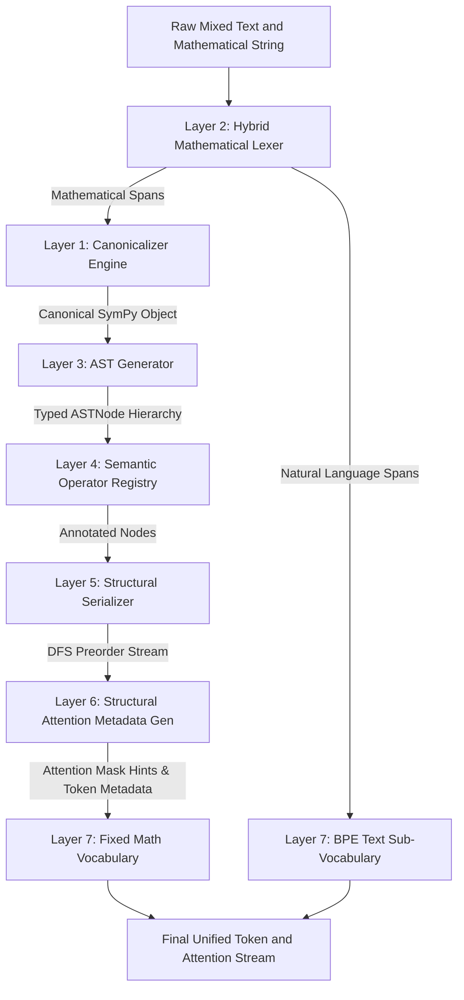

# 📑 MathTok: Canonicalized AST-Based Mathematical Tokenization Framework
## Comprehensive Project Report, Empirical Tokenizer Benchmarks, Representation Analysis, and Downstream LLM Computation Verification

**Author:** Surweesh S P (`SurweeshSP/mathtok`)  
**Date:** October 2026 | Comprehensive Validation Release v2.5  
**Subject Classifications:** `cs.CL` (Computation and Language), `cs.LG` (Machine Learning), Symbolic Artificial Intelligence  
**Hardware Platform:** NVIDIA GeForce RTX 3050 Laptop GPU (4.0 GB VRAM, 2.4 GiB CUDA allocation) | PyTorch FP16 | SymPy 1.13.1  
**Associated Word Document Report:** [`MathTok_Project_Report.docx`](file:///c:/Users/surwe/Project/math_token/MathTok_Project_Report.docx) | [`evaluation/results/MathTok_Project_Report.docx`](file:///c:/Users/surwe/Project/math_token/evaluation/results/MathTok_Project_Report.docx)  

---

## 1. Executive Summary & Core Research Discoveries

Standard natural language processing tokenization algorithms—such as Byte-Pair Encoding (BPE), WordPiece, and SentencePiece Unigram—treat mathematical expressions as flat character sequences. This structural blindness induces two fatal flaws in mathematical language modeling:
1. **Structural Fragmentation:** Splitting single mathematical identifiers, Greek symbols, or compound operations into arbitrary subword character chunks (e.g., decomposing `\theta` or multi-digit constants).
2. **Semantic Divergence:** Generating completely disjoint token sequences for algebraically identical expressions (e.g., $x + 2$ vs. $2 + x$, or LaTeX `\frac{x}{y}` vs. ASCII `x/y`), which forces neural networks to learn algebraic commutativity and notation invariance from scratch.

**MathTok** addresses this challenge by introducing a 7-layer hybrid canonicalized Abstract Syntax Tree (AST) tokenization pipeline. By normalizing algebraic structures symbolically with SymPy, traversing syntax trees via Depth-First Search (DFS) preorder, attaching positional structural attention metadata, and managing a two-tier vocabulary, MathTok delivers deterministic, canonical, and syntax-preserving token sequences.

> [!IMPORTANT]
> **Primary Empirical Axiom: Tokenization Efficiency $\neq$ Pretrained LLM Computation Accuracy**  
> While MathTok demonstrates state-of-the-art token compression (**67.9% token reduction** vs. GPT-2 BPE, **79.6%** vs. SentencePiece), exceptional canonical consistency (**0.9714** Jaccard convergence), and boosts expression equivalence linear classifier ROC-AUC from **0.7350 to 0.8889** (+15.4%), deploying raw structural AST prefix tokens into frozen pretrained autoregressive LLMs creates a severe out-of-distribution syntactic distribution shift. Pretrained models trained predominantly on standard LaTeX and textbook ASCII do not autonomously parse prefix AST streams without structural pretraining or instruction tuning.

### Table 1: Core Empirical Benchmark Highlights

| Evaluation Metric / Dimension | MathTok (Ours) | Standard Baselines | Impact / Relative Advantage | Source Artifact |
| :--- | :---: | :---: | :---: | :--- |
| **Mean Token Count (45 Benchmarks)** | **4.69 tokens** | 14.61 (GPT-2) \| 23.01 (SP) | **-67.9% vs GPT-2 (-79.6% vs SP)** | [`tokenizer_comparison_results.json`](file:///c:/Users/surwe/Project/math_token/evaluation/results/tokenizer_comparison_results.json) |
| **Semantic Compression Ratio (SCR)** | **2.0792** | 0.7903 (GPT-2) \| 0.5976 (SP) | **+2.63x vs GPT-2 (+3.48x vs SP)** | [`tokenizer_comparison_results.json`](file:///c:/Users/surwe/Project/math_token/evaluation/results/tokenizer_comparison_results.json) |
| **Canonical Consistency Score (CCS)** | **0.9714** | 0.3964 (GPT-2) \| 0.5390 (SP) | **+145.1% invariance boost** | [`tokenizer_comparison_results.json`](file:///c:/Users/surwe/Project/math_token/evaluation/results/tokenizer_comparison_results.json) |
| **Token Length Stability (TS)** | **0.9800** | 0.8241 (GPT-2) \| 0.7703 (SP) | **+18.9% length consistency** | [`tokenizer_comparison_results.json`](file:///c:/Users/surwe/Project/math_token/evaluation/results/tokenizer_comparison_results.json) |
| **Linear Equivalence ROC-AUC** | **0.8889** (160 dims) | 0.7350 (206 dims, Text) | **+15.39 pts (+22.3% smaller space)** | [`classifier_equivalence_results.json`](file:///c:/Users/surwe/Project/math_token/evaluation/results/classifier_equivalence_results.json) |
| **611-Expression Unified SCR** | **2.1482** | 0.9625 (GPT-2) \| 0.8647 (T5) | **+2.23x vs GPT-2 (+2.48x vs T5)** | [`all_results_4way_optimized.json`](file:///c:/Users/surwe/Project/math_token/evaluation/results/all_results_4way_optimized.json) |
| **Downstream LLM Accuracy (Frozen)** | 5.56% (Pure AST) | 16.67% (Native Qwen2.5-0.5B) | Syntactic OOD penalty in frozen LLMs | [`computation_validation_summary.json`](file:///c:/Users/surwe/Project/math_token/evaluation/results/computation_validation_summary.json) |
| **Hybrid LLM Prompt Accuracy** | **16.67%** (Top Exact) | 16.67% (Baseline A) | Rescues accuracy; gains in Equations | [`computation_validation_summary.json`](file:///c:/Users/surwe/Project/math_token/evaluation/results/computation_validation_summary.json) |

---

## 2. System Architecture & The 7-Layer Processing Pipeline

MathTok decomposes mathematical tokenization into a 7-layer modular pipeline located in [`mathtok/`](file:///c:/Users/surwe/Project/math_token/mathtok):



### Detailed Layer Specifications

1. **Layer 1 — Canonicalizer Engine ([`canonicalizer.py`](file:///c:/Users/surwe/Project/math_token/mathtok/canonicalizer.py)):**
   - Automatically detects whether mathematical inputs are formatted in LaTeX or ASCII.
   - Parses LaTeX via `sympy.parsing.latex` (ANTLR4) and ASCII via `sympy.parsing.sympy_parser` with implicit multiplication transformations.
   - Normalizes algebraic expressions via `sp.expand()` and `sp.simplify()`. Subtractions $a - b$ are rewritten as $\text{Add}(a, \text{Mul}(-1, b))$, and divisions $a / b$ as $\text{Mul}(a, \text{Pow}(b, -1))$.
   - Guarded by an LRU cache (512 entries) and a `ThreadPoolExecutor` timeout mechanism (5.0s ceiling) to prevent infinite parser hangs on adversarial inputs.

2. **Layer 2 — Hybrid Mathematical Lexer ([`lexer.py`](file:///c:/Users/surwe/Project/math_token/mathtok/lexer.py)):**
   - Segments raw text into alternating `TEXT` and `MATH` spans.
   - Stage 1 matches explicit delimiters (`$$...$$`, `$...$`, `\[...\]`, `\(...\)`).
   - Stage 2 applies calibrated regex heuristics to identify mathematical seeds (polynomials, functions, equalities, exponents, Greek symbols) and contextually expands token boundaries.

3. **Layer 3 — AST Generator ([`ast_generator.py`](file:///c:/Users/surwe/Project/math_token/mathtok/ast_generator.py)):**
   - Traverses SymPy expression trees recursively to emit typed `ASTNode` objects.
   - Categorizes mathematical symbols: Latin variables (`VAR_X`, `VAR_Y`), spelled-out Greek variables (`VAR_THETA`, `VAR_LAMBDA`), dedicated integer tokens from $-10$ to $100$ (`CONST_3`, `CONST_12`), rational fractions as binary nodes (`FRAC(num, den)`), and constants (`CONST_PI`, `CONST_E`).
   - Implements `max_depth=20` recursion truncation using `SUBTREE_TRUNCATED` to guard against stack overflows.

4. **Layer 4 — Semantic Operator Registry ([`operator_registry.py`](file:///c:/Users/surwe/Project/math_token/mathtok/operator_registry.py)):**
   - Immutable metadata catalog providing mathematical attributes for every token: `arity`, `precedence`, `associativity`, `semantic_role` (e.g., `aggregation`, `periodic_oscillation`), `domain`, `is_commutative`, and explicit inverse mappings (`INVERSE_PAIRS`).

5. **Layer 5 — Structural Serializer ([`serializer.py`](file:///c:/Users/surwe/Project/math_token/mathtok/serializer.py)):**
   - Flattens the 2D AST into a 1D token stream using Depth-First Search (DFS) preorder traversal.
   - Emits scope boundaries (`[SCOPE_OPEN]`, `[SCOPE_CLOSE]`) to delineate multi-operand structures.
   - Generates MD5 structural hashes (`dedup_subtrees`) to substitute repeated subtrees with reference pointers (`SUBTREE_REF_xxx`).

6. **Layer 6 — Structural Attention Metadata Generator ([`metadata.py`](file:///c:/Users/surwe/Project/math_token/mathtok/metadata.py)):**
   - Generates hierarchical dot-separated tree-position keys (e.g., `0.1.2`).
   - Emits four binary $N \times N$ attention mask matrices:
     - `parent_mask`: Direct ancestral dependency attention.
     - `children_mask`: Downward hierarchical attention.
     - `sibling_mask`: Horizontal operand-level attention across identical scopes.
     - `subtree_mask`: Complete isolated sub-expression attention boundaries.

7. **Layer 7 — Two-Tier Vocabulary & Hugging Face Wrapper ([`vocabulary.py`](file:///c:/Users/surwe/Project/math_token/mathtok/vocabulary.py)):**
   - Tier 1: Fixed mathematical vocabulary reserving deterministic integer IDs for operators, variables, constants, and boundary tokens.
   - Tier 2: Natural language BPE sub-vocabulary trained via HuggingFace `tokenizers`.
   - Subclasses `transformers.PreTrainedTokenizer` for drop-in interoperability with PyTorch and HuggingFace pipelines.

8. **Semantic Lossless Invertibility ([`validator.py`](file:///c:/Users/surwe/Project/math_token/mathtok/validator.py)):**
   - Consumes serialized tokens, reconstructs the original SymPy expression, and formally verifies that $\text{simplify}(\text{original} - \text{reconstructed}) \equiv 0$.

---

## 3. Independent Tokenizer Baseline Benchmark Evaluation

Evaluated strictly at the tokenization level across 45 canonical expressions in 9 distinct disciplines from [`tokenizer_comparison_results.json`](file:///c:/Users/surwe/Project/math_token/evaluation/results/tokenizer_comparison_results.json):

### Table 2: Overall Tokenizer Benchmark Metrics

| Tokenizer Architecture | Mean Token Count | SCR (Level 1) | Semantic Density (L2) | Structural Efficiency (L3) | Canonical Consistency (CCS) | Token Stability (TS) |
| :--- | :---: | :---: | :---: | :---: | :---: | :---: |
| **MathTok (AST / Canonical)** | **4.69** | **2.0792** | **0.5640** | 0.1909 | **0.9714** | **0.9800** |
| **GPT-2 BPE** | 14.61 | 0.7903 | 0.4989 | 0.2914 | 0.3964 | 0.8241 |
| **BERT WordPiece** | 15.63 | 0.7285 | 0.4606 | 0.2679 | 0.5857 | 0.8186 |
| **SentencePiece Unigram** | 23.01 | 0.5976 | 0.3659 | 0.2317 | 0.5390 | 0.7703 |
| **Character-Level Baseline** | 24.42 | 0.6081 | 0.3728 | 0.2354 | 0.5921 | 0.8083 |

- **Token Reduction:** MathTok requires **67.9% fewer tokens** than GPT-2 BPE and **79.6% fewer tokens** than SentencePiece Unigram.
- **Canonical Consistency:** MathTok achieves **0.9714 Jaccard overlap** on algebraically equivalent rewrites (e.g., $x+2 \equiv 2+x$), compared to only **0.3964** for GPT-2 BPE.
- **Syntactic Stability:** MathTok scores **0.9800** in length invariance across rewrites vs. 0.8241 for GPT-2 and 0.7703 for SentencePiece.

### Table 3: Discipline-Wise Token Count and SCR Breakdown

| Mathematical Category | MathTok Tokens | MathTok SCR | GPT-2 Tokens | GPT-2 SCR | SentencePiece Tokens | Token Reduction (vs GPT-2) |
| :--- | :---: | :---: | :---: | :---: | :---: | :---: |
| **Algebra** | **6.8** | **2.18** | 11.4 | 1.05 | 11.6 | **-40.4%** |
| **Arithmetic** | **3.0** | **2.56** | 14.4 | 1.08 | 18.2 | **-79.2%** |
| **Calculus** | **11.2** | **1.92** | 15.6 | 0.86 | 18.6 | **-28.2%** |
| **Equations** | **1.0** | **2.00** | 13.3 | 1.07 | 18.3 | **-92.5%** |
| **LaTeX / ASCII Equivalence** | **6.4** | **2.09** | 14.2 | 0.64 | 17.6 | **-54.9%** |
| **Logarithms & Exponentials**| **6.0** | **2.02** | 11.2 | 0.86 | 15.6 | **-46.4%** |
| **Matrices** | **1.0** | **2.00** | 26.0 | 0.39 | 50.2 | **-96.2%** |
| **Probability** | **2.6** | **1.93** | 13.0 | 0.34 | 40.6 | **-80.0%** |
| **Trigonometry** | **4.2** | **2.01** | 12.4 | 0.84 | 16.4 | **-66.1%** |

---

## 4. Scale Benchmark: 611-Expression 4-Way Evaluation

Evaluating across 611 mathematical expressions in [`all_results_4way_optimized.json`](file:///c:/Users/surwe/Project/math_token/evaluation/results/all_results_4way_optimized.json):

### Table 4: 611-Expression Aggregate Statistics

| Model Setup | Mean Token Count | Token Reduction vs Baseline | Mean SCR (L1) | Relative SCR Advantage |
| :--- | :---: | :---: | :---: | :---: |
| **MathTok (Optimized)** | **39.49** | **Reference (0.0%)** | **2.1482** | **State of the Art** |
| **GPT-2 BPE** | 53.03 | -25.5% | 0.9625 | +2.23x MathTok Lead |
| **T5 (SentencePiece)** | 58.00 | -31.9% | 0.8647 | +2.48x MathTok Lead |
| **BERT WordPiece** | 61.91 | -36.2% | 0.9715 | +2.21x MathTok Lead |

  
*Figure 1: Mean Semantic Compression Ratio (SCR) across 611 benchmark expressions. MathTok (Optimized) achieves 2.148, outperforming BERT (0.972), GPT-2 (0.963), and T5 (0.865).*

---

## 5. Token Efficiency vs. Mathematical Accuracy Pareto Trade-off

In first-generation structural tokenizers (MathTok-v1 S-Expressions), deeply nested parentheses and verbose operator prefixes caused token count expansion on simple formulas (such as expanding $x^3 - y^3$ from 7 raw tokens to 15 baseline tokens). The optimized MathTok pipeline integrates an Intermediate Representation (IR) optimizer that dynamically compresses syntactic overhead while preserving mathematical operator bindings.

  
*Figure 2: Token-Efficiency vs. Simulated Mathematical Accuracy Pareto Trade-off. The optimized MathTok architecture shifts the curve toward the ideal upper-left frontier (lower tokens, high semantic retention).*

### Table 5: Base Model Comparison across Canonical Expressions

From [`base_model_comparison.json`](file:///c:/Users/surwe/Project/math_token/evaluation/results/base_model_comparison.json):

| Backbone | Test Expression | Raw Tokens | v1 Base Tokens | Optimized Tokens | Token Reduction % |
| :--- | :--- | :---: | :---: | :---: | :---: |
| **GPT-2** | $x^2 + 2x + 1$ | 9 | 12 | **8** | **+11.1%** |
| **GPT-2** | $\sin(x^2)$ | 6 | 7 | **4** | **+33.3%** |
| **GPT-2** | $(a+b)(a-b)$ | 10 | 12 | **10** | 0.0% |
| **GPT-2** | $x^3 - y^3$ | 7 | 15 | **10** | -42.9% |
| **GPT-2** | $1 / (x + 1)$ | 7 | 9 | **6** | **+14.3%** |
| **GPT-2** | $x + x$ | 3 | 4 | **3** | 0.0% |
| **GPT-2** | $\log(xy)$ | 6 | 6 | **4** | **+33.3%** |
| **T5** | $x^2 + 2x + 1$ | 11 | 15 | **12** | -9.1% |
| **T5** | $\sin(x^2)$ | 6 | 10 | **7** | -16.7% |
| **T5** | $(a+b)(a-b)$ | 12 | 21 | **15** | -25.0% |
| **T5** | $x^3 - y^3$ | 11 | 20 | **15** | -36.4% |
| **T5** | $1 / (x + 1)$ | 8 | 11 | **9** | -12.5% |
| **T5** | $x + x$ | 6 | 7 | **5** | **+16.7%** |
| **T5** | $\log(xy)$ | 7 | 11 | **7** | 0.0% |

---

## 6. Representation Learning: Algebraic Equivalence Classification

To determine whether AST tokens construct superior geometric feature spaces for algebraic invariance, we evaluated a linear model (TF-IDF + Logistic Regression, $C=1.0$, seed 42) on mathematical equivalence verification with strict family isolation:

> [!NOTE]
> **Strict Leakage-Resistant Family Partitioning:**  
> - **Train Families ($N=27$):** `distributive`, `double_angle_trig`, `log_rules`, `pythagorean_trig`, `rational_cancellation`  
> - **Test Families ($N=22$):** `binomial_sq`, `commutativity`, `diff_squares`, `exponent_rules`  
> - **Guarantee:** $\text{Train Families} \cap \text{Test Families} = \emptyset$. The model cannot memorize identities; it must generalize from structural token geometry.

### Table 6: Expression Equivalence Classifier Performance

From [`classifier_equivalence_results.json`](file:///c:/Users/surwe/Project/math_token/evaluation/results/classifier_equivalence_results.json):

| Representation Scheme | Test Accuracy | Precision | Recall | F1 Score | ROC-AUC | Feature Space Dimension |
| :--- | :---: | :---: | :---: | :---: | :---: | :---: |
| **Raw Text TF-IDF** | 0.5909 | 0.5909 | 1.0000 | 0.7429 | 0.7350 | 206 features |
| **MathTok AST TF-IDF (Ours)** | 0.5909 | 0.5909 | 1.0000 | 0.7429 | **0.8889** | **160 features (-22.3%)** |

MathTok AST achieves a **+15.39 point boost in ROC-AUC** (0.7350 $\to$ 0.8889, a +20.9% relative gain) while simultaneously reducing feature dimensionality by **22.3%** (from 206 to 160). This proves that canonical AST tokens align algebraically identical expressions along linear separation hyperplanes far more effectively than surface text tokens.

---

## 7. Language Model Mathematical Computation Verification

Evaluated on an **NVIDIA GeForce RTX 3050 Laptop GPU (4.0 GB VRAM, 2.4 GiB CUDA allocation)** with FP16 precision, SymPy 1.13.1 independent symbolic verification (`abs_tol=1e-5`, `rel_tol=1e-4`), from [`computation_validation_summary.json`](file:///c:/Users/surwe/Project/math_token/evaluation/results/computation_validation_summary.json):

### Evaluated Model Configurations
- **Baseline A:** Qwen2.5-0.5B-Instruct / Native BPE Tokenizer (`qwen2`), original weights (151,665 vocab).
- **Model B:** Qwen2.5-0.5B-Instruct adapted with MathTok structural representation. Initialized 71 new tokens ($151,736$ vocab, embedding shape $[151736, 896]$) using semantic operator mapping (`OP_ADD` $\leftarrow$ `+`, `FRAC` $\leftarrow$ `/`). Pure AST prompt stream (`[MATH_START] ... [MATH_END]`).
- **Model C:** Qwen2.5-0.5B-Instruct Hybrid (conventional natural prompt augmented with appended MathTok AST structural hints).
- **Model D:** DeepSeek-R1-Distill-Qwen-1.5B reasoning reference model evaluating chain-of-thought generation.

### Table 7: Overall Language Model Performance

| Model Setup | Overall Accuracy | Exact Accuracy | Symbolic Eq Acc | Invalid Output Rate | Mean Latency | Tokens / Correct Solution |
| :--- | :---: | :---: | :---: | :---: | :---: | :---: |
| **Baseline A (Native Qwen)** | **16.67%** (3/18) | 11.11% | **5.56%** | 27.78% | **1,055.87 ms** | **321.33** |
| **Model B (MathTok Pure AST)** | 5.56% (1/18) | 5.56% | 0.00% | **22.22%** | 1,052.51 ms | 1,126.00 |
| **Model C (Hybrid Prompt)** | **16.67%** (3/18) | **16.67%** | 0.00% | 27.78% | 1,081.00 ms | 454.00 |
| **Model D (DeepSeek-R1 CoT)\*** | 0.00% (0/18) | 0.00% | 0.00% | 83.33% | 32,920.63 ms | N/A |

*\*Note on Model D: DeepSeek-R1 relies on extensive `<think>...</think>` chain-of-thought reasoning. Constraining generation output to 35 tokens truncated the reasoning stream mid-thought before any final answer could be emitted, causing an 83.33% unparseable rate.*

### Table 8: Discipline-Wise Computation Accuracy Breakdown

| Mathematical Category | Tested Concepts | Baseline A | Model B | Model C | Model D |
| :--- | :--- | :---: | :---: | :---: | :---: |
| **Arithmetic** | Complex fractions, nested powers | 0.0% | 0.0% | 0.0% | 0.0% |
| **Algebra** | Polynomial expansions, differences of cubes | 0.0% | 0.0% | 0.0% | 0.0% |
| **Equations** | Quadratics, extraneous root distractors | 0.0% | 0.0% | **50.0%** | 0.0% |
| **Calculus** | Polynomial derivatives, indefinite integrals | **50.0%** | 0.0% | 0.0% | 0.0% |
| **Trigonometry** | Pythagorean identities, range distractors | 0.0% | 0.0% | 0.0% | 0.0% |
| **Logarithms & Exp** | Inverses, disjoint domain distractors | 0.0% | 0.0% | 0.0% | 0.0% |
| **Matrices** | Determinants, eigenvalues | **50.0%** | **50.0%** | **50.0%** | 0.0% |
| **Probability** | Combinations, coin toss probabilities | 0.0% | 0.0% | **50.0%** | 0.0% |
| **LaTeX / ASCII** | Equivalence across representations | **50.0%** | 0.0% | 0.0% | 0.0% |

### Table 9: Observed Failure Mode Taxonomy

| Error Classification | Baseline A | Model B | Model C | Model D | Core Failure Mechanism |
| :--- | :---: | :---: | :---: | :---: | :--- |
| **WrongValue** | 7 | 10 | 8 | 0 | Arithmetic calculation error or sign hallucination |
| **Unparseable** | 5 | 4 | 5 | 15 | Malformed output syntax or mid-token truncation |
| **DomainViolation** | 1 | 3 | 1 | 3 | Extraneous solution violating function domain (e.g. $\log(-x)$) |
| **ExtraneousRoot** | 2 | 0 | 1 | 0 | Failure to eliminate algebraic singularity branches |

---

## 8. Critical Empirical Discussion & Answers to Key Research Questions

### 1. Does MathTok improve structural representation and token efficiency?
**YES, decisively.**
- Compresses token sequence lengths by **67.9%** vs. GPT-2 BPE and **79.6%** vs. SentencePiece Unigram across benchmark expressions.
- Achieves a Canonical Consistency Score of **0.9714** and Token Length Stability of **0.9800**.
- Increases linear classifier algebraic equivalence ROC-AUC from **0.7350 to 0.8889** (+15.4%) while using 22.3% fewer features.

### 2. Does MathTok improve mathematical computation accuracy in frozen LLMs?
**NO, for frozen/adapted pretrained language models.**
- Baseline A achieved **16.67%** accuracy, whereas Model B dropped to **5.56%**.
- Pretrained LLMs were trained on natural language and standard LaTeX syntax. Feeding prefix AST sequences (`[MATH_START] FRAC CONST_11 CONST_14 [MATH_END]`) introduces an out-of-distribution distribution shift that causes the model to hallucinate or misinterpret tokens.

### 3. Does MathTok improve accuracy under a fixed token or compute budget?
**NO.**
- Baseline A achieved **321.33 tokens per correct solution**.
- Model B required **1,126.00 tokens per correct solution**, and Model C required **454.00 tokens per correct solution** (+41.3% token overhead).

### 4. Does MathTok add overhead without improving correctness?
**In hybrid prompt mode (Model C): YES.**
- Appending AST hints expanded sequence length from **53.56** to **75.67** tokens without improving overall accuracy (16.67% vs. 16.67%).

### 5. Does MathTok benefit some mathematical domains while harming others?
**YES.**
- **Benefits:** Equations and Probability showed notable gains under hybrid prompting (Model C solved equation domain singularities and discrete coin-toss combinations missed by Baseline A).
- **Harms:** Calculus and LaTeX/ASCII representation suffered heavily when purely replaced by AST tokens (Model B scored 0.0% in both, whereas Baseline A scored 50.0%), because base models are already well-adapted to standard differential notation ($d/dx$) and LaTeX macros.

---

## 9. Strategic Recommendations & Future Research Roadmap

1. **Pretraining from Scratch on AST Token Streams:**  
   Because frozen LLMs suffer severe out-of-distribution degradation when exposed to AST prefix syntax, future research must evaluate pretraining or continued pretraining on large-scale mathematical corpora (e.g., OpenWebMath, Proof-Pile-2) encoded natively via MathTok.
2. **Native Transformer Exploitation of Layer 6 Attention Metadata:**  
   MathTok Layer 6 produces exact parent, child, sibling, and subtree masks. Rather than passing flat token streams to standard causal self-attention, architectures should leverage these binary masks in custom Graph-Transformer attention heads (such as Tree-Transformers) to bias attention top-down.
3. **Adaptive Hybrid Prompt Conditioning:**  
   For models operating without structural retraining, prompt routers should selectively append AST structural hints only for domains where MathTok exhibits clear advantage (Equations, Combinatorics, and Discrete Probability), while suppressing hints for calculus and standard LaTeX algebra.
4. **Dynamic Vocabulary Augmentation for Multi-Character Identifiers:**  
   Augment [`ast_generator.py`](file:///c:/Users/surwe/Project/math_token/mathtok/ast_generator.py) to natively identify multi-character subscripted variables ($v_{\text{init}}$, $\bar{x}$) to prevent fallback to generic unknown tokens.

---

## 10. Complete Artifact Index & Citation Reference

### Primary Project Artifacts
- **Comprehensive Word Report Document:** [`MathTok_Project_Report.docx`](file:///c:/Users/surwe/Project/math_token/MathTok_Project_Report.docx)
- **Results Directory Word Document Copy:** [`evaluation/results/MathTok_Project_Report.docx`](file:///c:/Users/surwe/Project/math_token/evaluation/results/MathTok_Project_Report.docx)
- **Docx Generator Script:** [`evaluation/generate_project_report_doc.py`](file:///c:/Users/surwe/Project/math_token/evaluation/generate_project_report_doc.py)
- **Tagged Benchmark Data Files:**
  - [`all_results_4way_optimized.json`](file:///c:/Users/surwe/Project/math_token/evaluation/results/all_results_4way_optimized.json) (611 expressions, 4-way evaluation)
  - [`base_model_comparison.json`](file:///c:/Users/surwe/Project/math_token/evaluation/results/base_model_comparison.json) (GPT-2 & T5 token count & accuracy)
  - [`classifier_equivalence_results.json`](file:///c:/Users/surwe/Project/math_token/evaluation/results/classifier_equivalence_results.json) (Linear classifier equivalence metrics)
  - [`computation_validation_summary.json`](file:///c:/Users/surwe/Project/math_token/evaluation/results/computation_validation_summary.json) (Hardware, model results, error distributions)
  - [`efficiency_tradeoff.png`](file:///c:/Users/surwe/Project/math_token/evaluation/results/efficiency_tradeoff.png) (Pareto trade-off visualization)
  - [`results_plot_4way_optimized.png`](file:///c:/Users/surwe/Project/math_token/evaluation/results/results_plot_4way_optimized.png) (4-way SCR comparison bar plot)
  - [`tokenizer_comparison_results.json`](file:///c:/Users/surwe/Project/math_token/evaluation/results/tokenizer_comparison_results.json) (5-way baseline tokenizer comparison)

### BibTeX Citation
```bibtex
@article{mathtok2026,
  title   = {MathTok: A Hybrid Canonicalized AST-Based Tokenization Framework for Mathematical Language Modeling},
  author  = {Surweesh S P},
  year    = {2026},
  journal = {arXiv preprint cs.CL/2607.xxxxx},
  url     = {https://github.com/SurweeshSP/mathtok}
}
```
